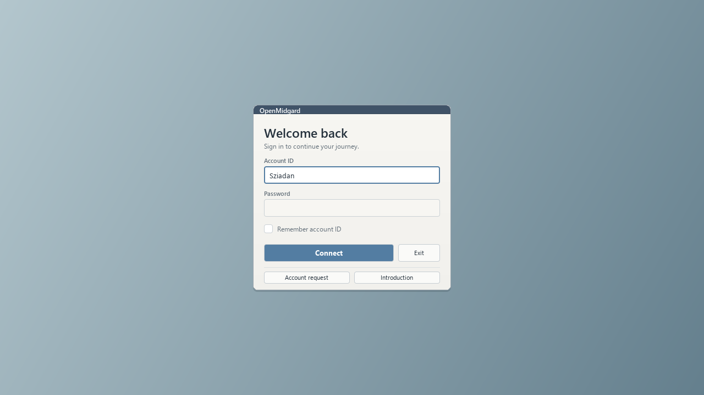
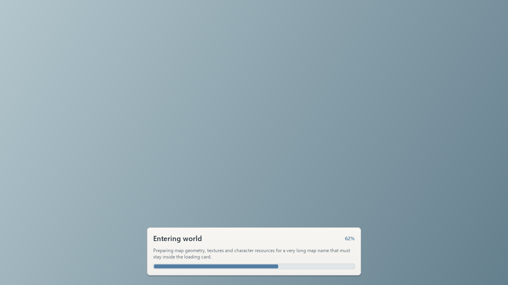

# Qt login and loading presentation

The login panel now uses the shared RoFrame, RoTheme, RoField and RoTextButton
components. It has labeled account/password fields, an emphasized Connect
action, a readable remember-account row and the existing secondary actions.
It switches to a compact layout when the logical viewport is short. Passwords
remain masked; remembered-ID storage, Enter/Tab/Escape and login messages are
unchanged. No new account-registration or introduction behavior is added.

LoginLayout.h supplies both native hit rectangles and QML render data. The
whole remember-account label is clickable. The server selector remains the
existing selector, centered above the wider card with space reserved when
present. The obsolete Qt login-panel bitmap provider is removed, and Qt login
no longer loads legacy panel/control art. Existing screen wallpapers remain.

The loading card uses its content's implicit height instead of a fixed height.
Messages wrap to two lines, and the progress track stays inside the card's
padding. Progress is clamped to 0–100%; an animated segment handles waiting
without measurable progress. It uses the same UI scale and theme as the other
windows.

Character selection and creation native files are unchanged. A source comparison
also confirms that their complete GameOverlay.qml sections are byte-identical
to the previous commit. The shared button's new primary variant defaults off.

Validation: all 56 Qt preview fixtures pass at 100%, 125%, 150% and 200% scales
across 1280×720 and 640×480 viewports. They check login controls against native
hit rectangles and loading message/track/fill containment. The compiled native
login input regression passes focus, remember-label clicks, button dispatch,
responsive bounds and hidden/outside clicks. The MinGW Qt and Linux Qt/Vulkan
clients both build successfully.
The actual client is left for user testing; previews use synthetic data/art.

